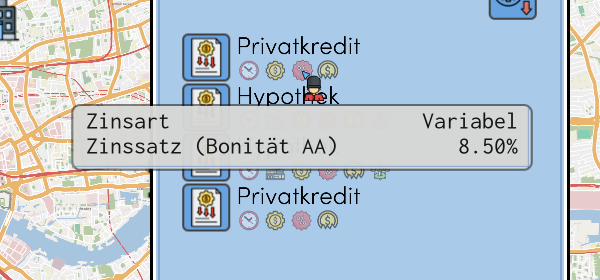
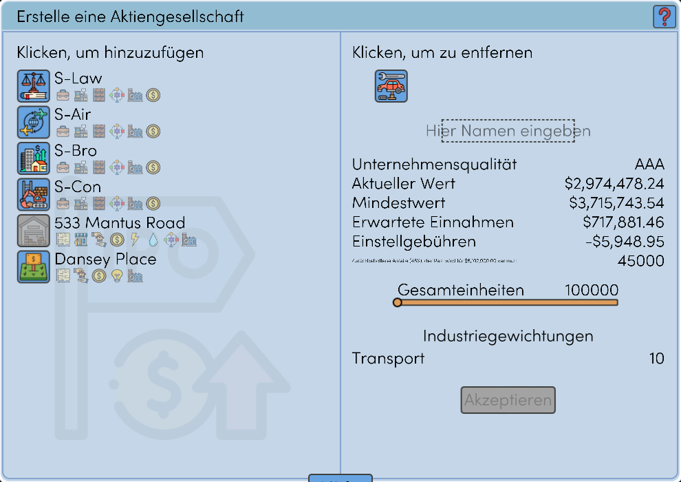
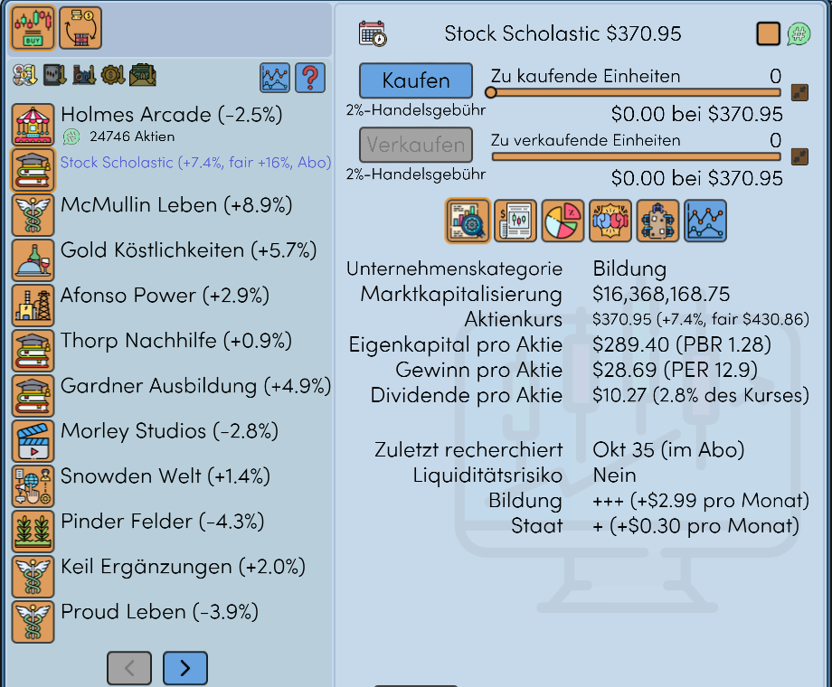
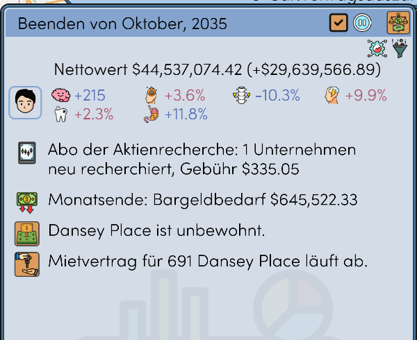
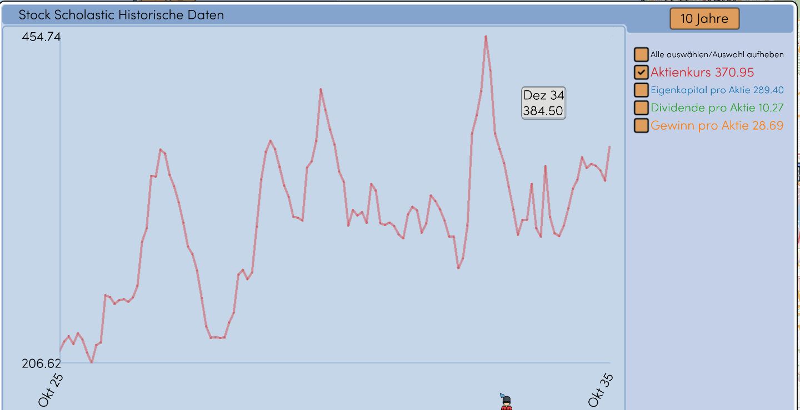
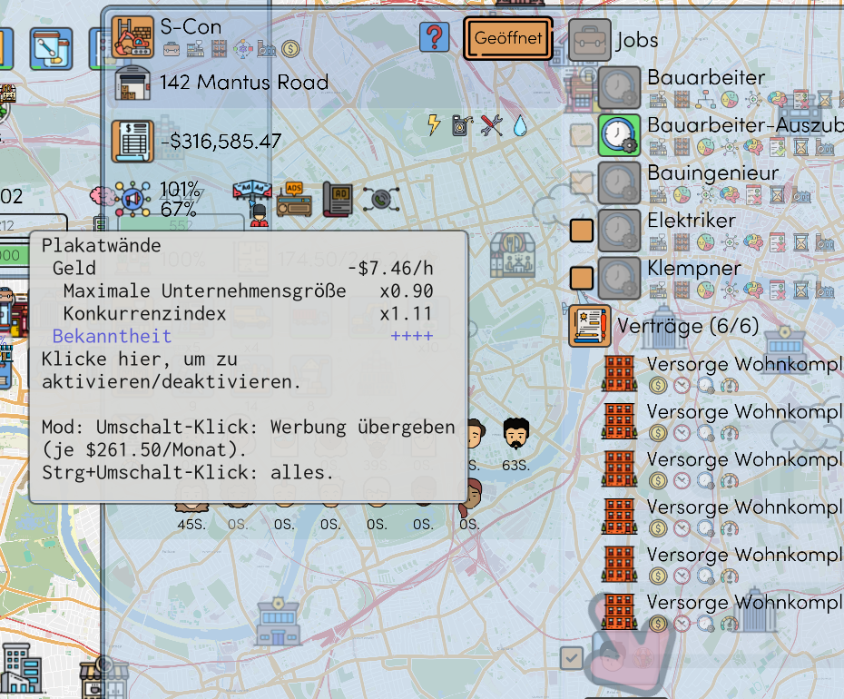
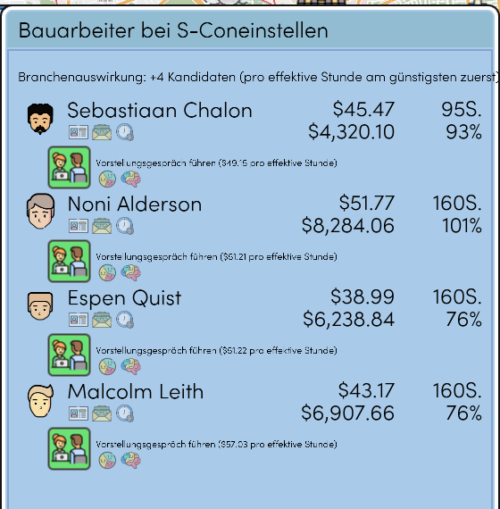

# Realistic Economy

Ein Mod für This Grand Life 2. Nur für die Spielversion v1.03.22, Mod-Version 1.5.0. Nicht vom Entwickler des Spiels.

Andere Sprachen: [English](README.md), [한국어](README.ko.md), [Español](README.es.md), [Français](README.fr.md), [Português (Brasil)](README.pt-BR.md), [日本語](README.ja.md), [简体中文](README.zh-CN.md)

## Kreditzinsen richten sich nach der Bonität

Zins = Zinssatz der Zentralbank + Aufschlag. Die Bonität deines Haushalts (AAA bis B) bestimmt den Aufschlag. Weniger Schulden und mehr Einkommen und Bargeld geben eine bessere Bonität.

## Ein Börsengang bringt Bargeld

Das Spiel gibt dir 25 % der Aktien und kein Bargeld. Mit dem Mod behältst du 45 %, und die anderen 55 % werden zum Ausgabekurs verkauft. Die kleine Zeile unter der Gebühr zeigt dieses Bargeld.

## Aktien: Kennzahlen, Recherche-Abo, Sitze im Direktorium

- Neben dem Aktienkurs: die Änderung zum Vormonat, PBR, PER und Dividendenrendite.
- Ein Umschalt-Klick auf ein Unternehmen abonniert seine Recherche. Der Mod recherchiert es jeden Monat neu, gegen eine Gebühr, und zeigt seinen fairen Kurs. Strg+Umschalt-Klick abonniert alle Unternehmen.
- Je 20 % der Aktien eines börsennotierten Unternehmens ist ein Sitz im Direktorium garantiert. Du nominierst im Monat der Wahl ein Haushaltsmitglied.

Die monatliche Zusammenfassung nennt die Recherche und ihre Gebühr und das Bargeld, das dieses Monatsende kostet.

## Diagramme

Das Diagramm eines Unternehmens öffnet sich nur mit dem Aktienkurs. Jede Linie hat ihre eigene Farbe, und ihr letzter Wert steht neben ihrem Namen. Der Zeitknopf hat jetzt auch sechs Monate.

## Geschäfte automatisieren

Mitarbeiter, Vermögenswerte, Werbung und Verträge lassen sich einzeln an den Mod übergeben, für jedes Geschäft. Ein Strg+Umschalt-Klick auf ein Werbesymbol übergibt alles. Die Hinweistexte der Symbole nennen die Klicks. Die Übergabe öffnet sich, sobald dein Haushalt ein eigenes Unternehmen an die Börse gebracht hat (IPO). Was noch an Händen fehlt, wird ausgelagert oder eingestellt, wenn das weniger kostet als der Ruf, den es hält. Ein neues Geschäft ohne Mitarbeiter, ganz übergeben, startet der Mod selbst: erste Mitarbeiter, Vermögenswerte und Inventar.

Der Reiter zum Einstellen nennt zuerst, wer dieselbe Arbeit günstiger macht (Lohn pro Stunde ÷ Arbeitseffizienz).

## Behobene Fehler des Spiels

- Das Spiel beendete sich nach einigen Dutzend Ladevorgängen
- Falsche Übersetzungen in mehreren Sprachen
- Kästchen statt Buchstaben in Personennamen
- Eine Hypothek, die höher ausfiel als der von der Bank genehmigte Betrag
- Ein monatlicher Dauerauftrag, der Aktien ohne Bargeld kaufte
- Ein Gleichstand bei einer Wahl des Direktoriums, der das Spiel beendete
- Ein Bauauftrag, der seinen Bauingenieur nie verlangte

## Geschmackssache, und wie man sie abschaltet

Das sind alle Funktionen, die eine Regel oder eine Zahl des Spiels ändern. Setze den Wert in `RealisticEconomy.ini` im Spielordner auf 0, und dieser Teil ist wieder wie im Spiel.

| Funktion | Was anders ist als im Spiel | Aus |
|---|---|---|
| Balance | Aktiengebühr 2% (Spiel: 1%), Gebühr für Termingeschäfte 10% der Marge (1%), höherer Sparzins und Zinsen auf Bargeld, eine Miete, die bei der Verlängerung auch sinken kann, ein neues Geschäft beginnt mit 25% Bekanntheit (0%) | `[features] balance=0` |
| Handelssperre nach dem Laden | Nach dem Laden eines früheren Spielstands sind Aktien- und Termingeschäfte gesperrt, bis dieser Monat wieder vorbei ist. Aktienkurse und Immobilienangebote des Monats bleiben nach dem Laden dieselben | `[features] guard=0` |
| Kreditzinsen nach Bonität | Der Zins eines Kredits richtet sich nach der Bonität des Haushalts | `[features] credit=0` |
| Börsengang | Du behältst 45% und bekommst für den Rest Bargeld (Spiel: 25%, kein Bargeld) | `[features] ipo=0` |
| Sitze im Direktorium | Je 20% der Aktien ein garantierter Sitz | `[features] board=0` |
| Casino | Fester Einsatz und feste Chancen, jedes Spiel einmal im Monat | `[features] casino=0` |
| Abgeschlossene Ausbildung | Ihr Wert sinkt nicht | `[features] experience=0` |
| Automatisierung der Geschäfte | Der Mod verwaltet Personal, Vermögenswerte, Werbung und Verträge nur in einem Geschäft, das du ihm übergibst. Derselbe Klick holt es zurück | `[features] business=0` |
| Konkurrenz | Im Markt einer Geschäftsart zählen die Firmen 1,25-fach, die Konkurrenz setzt früher ein | `[balance] competitionWeight=1` |
| Bonus für den Ruf | Der monatliche Bonus eines Geschäfts für erledigte Arbeit (3,6 Punkte) sinkt mit dem Anteil liegen gebliebener Arbeit und ist bei 2% weg, statt für eine Stunde ganz verloren zu gehen | `[balance] reputationBonusFade=0` |
| Geld für Einfluss | Zwei große Spenden bei der Bank ($1M, $10M); die Stadt stimmt alle 12 Monate über ihre Politik ab (Spiel: 24); die Spende des Spiels selbst einmal im Jahr (Spiel: jeden Monat) | `[features] influence=0` |
| Persönliches Coaching | Im Krankenhaus rückt gegen Geld eine gewählte Vorliebe eine Stufe näher an Gefallen; eine pro Person und Jahr | `[features] coaching=0` |

Jede Zahl der Balance hat ihre eigene Zeile unter `[balance]`.

## Weitere Funktionen

Jede lässt sich in der Einstellungsdatei abschalten.

- Die Kandidaten eines Monats bleiben nach dem Laden dieselben
- Ein Hinweis, wenn eine Immobilie deutlich unter ihrem Wert angeboten wird
- Im Fenster, in dem man die Art eines neuen Geschäfts wählt: Umsatz und Kosten eines Monats mit allen Kunden

## Installation

1. Schließe das Spiel.
2. Entpacke die Zip-Datei aus den [Releases](../../releases) in den Spielordner (dort liegt `TGL2.exe`).
3. Starte `RealisticEconomy_install.bat`. Die Datei kopiert zuerst deine Spielstände nach `saves_before_RealisticEconomy_1`.

Zum Entfernen starte `RealisticEconomy_uninstall.bat`. Die Einstellungen stehen in `RealisticEconomy.ini`. Das vollständige Handbuch ist auf Englisch: [docs/RealisticEconomy_README_en.txt](docs/RealisticEconomy_README_en.txt).

Ein Virenscanner kann `version.dll` melden. Das ist der öffentliche Ultimate ASI Loader. Nach einem Update des Spiels schaltet sich der Mod selbst ab.

MIT-Lizenz. Der Quelltext liegt in [src](src).
