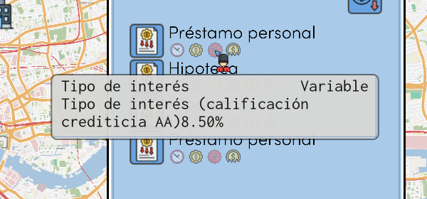
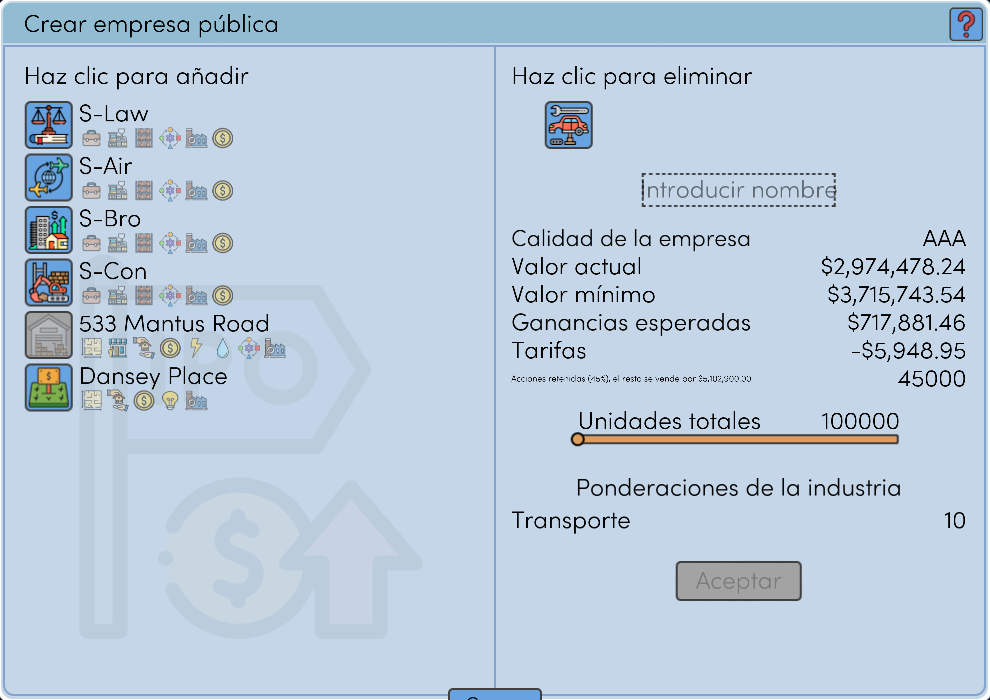
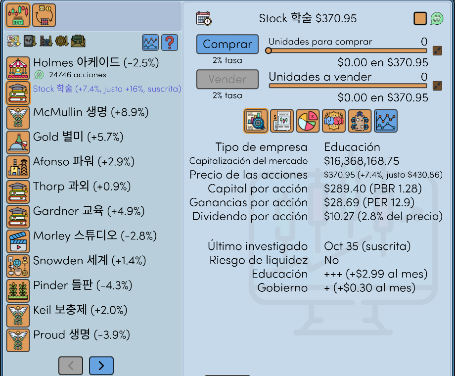
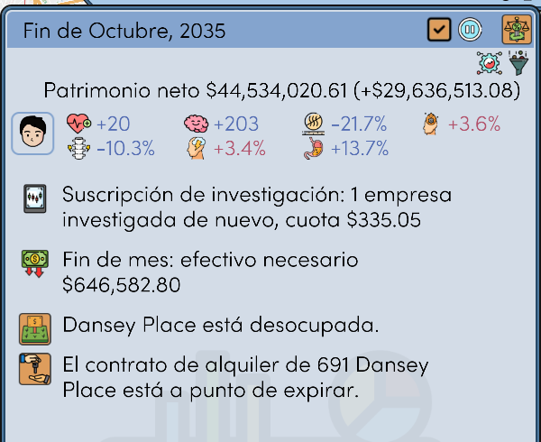
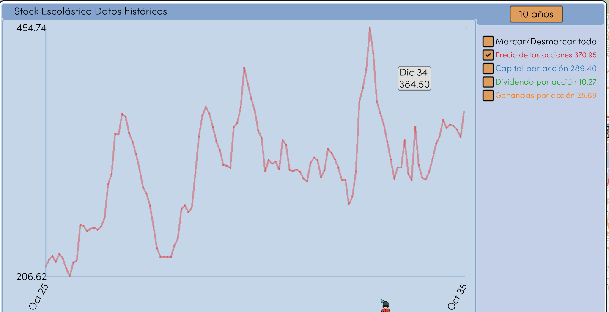
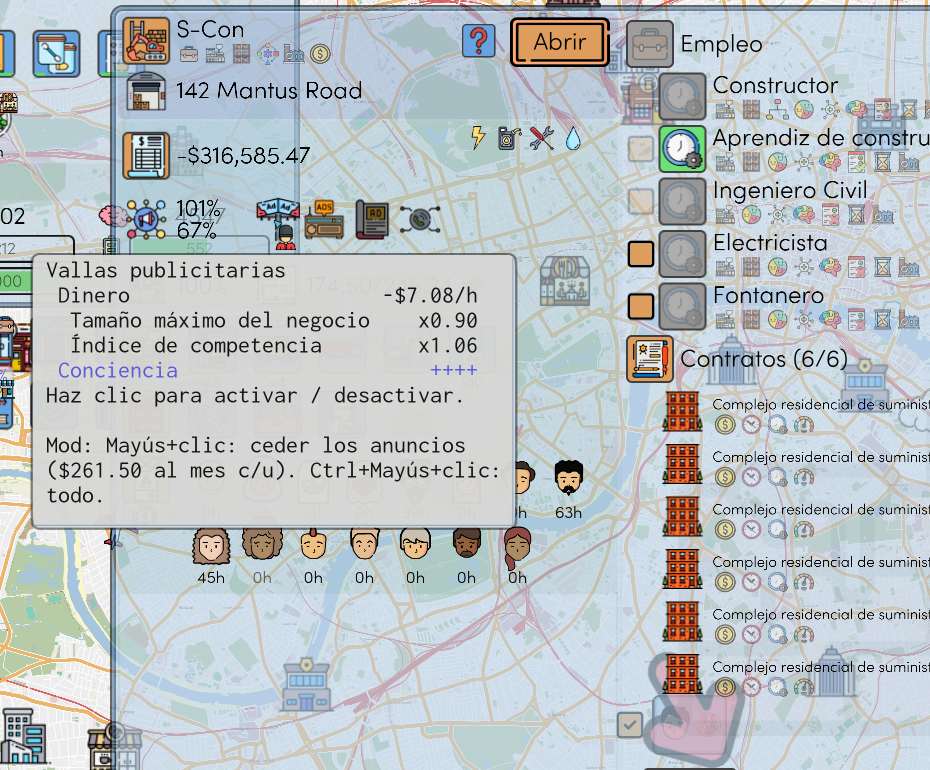
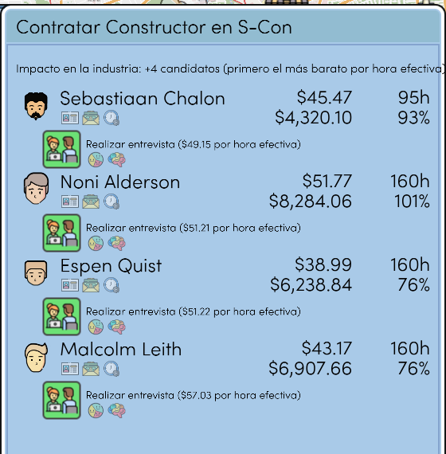

# Realistic Economy

Un mod para This Grand Life 2. Solo para la versión v1.03.22 del juego, versión 1.2.1 del mod. No es del desarrollador del juego.

Otros idiomas: [English](README.md), [한국어](README.ko.md), [Deutsch](README.de.md), [Français](README.fr.md), [Português (Brasil)](README.pt-BR.md), [日本語](README.ja.md), [简体中文](README.zh-CN.md)

## El interés de los préstamos sigue tu calificación crediticia

Interés = tipo de interés del Banco Central + un margen. La calificación crediticia de tu hogar (de AAA a B) fija el margen. Menos deuda y más ingresos y efectivo dan una calificación mejor.

## Una salida a bolsa te da efectivo

El juego te da el 25 % de las acciones y nada de efectivo. Con el mod conservas el 45 %, y el otro 55 % se vende al precio de salida. La línea pequeña bajo las tarifas muestra ese efectivo.

## Acciones: indicadores, suscripción de investigación, puestos en el Consejo

- Junto al precio de la acción: el cambio desde el mes pasado, PBR, PER y rentabilidad por dividendo.
- Con Mayús+clic en una empresa te suscribes a su investigación. El mod la investiga de nuevo cada mes, por una cuota, y muestra su precio justo. Ctrl+Mayús+clic suscribe todas las empresas.
- Cada 20 % de las acciones de una empresa cotizada garantiza un puesto en el Consejo de Administración. Nominas a un miembro de tu hogar en el mes de la elección.

El resumen mensual indica la investigación y su cuota, y el efectivo que se llevará este fin de mes.

## Gráficos

El gráfico de una empresa se abre solo con el precio de la acción. Cada línea tiene su color, y su último valor aparece junto a su nombre. El botón de tiempo ahora tiene seis meses.

## Automatización de los negocios

Empleados, activos, anuncios y contratos se pueden dejar al mod uno por uno, en cada negocio. Con Ctrl+Mayús+clic en un icono de anuncio se deja todo. Los textos de los iconos indican los clics.

La pestaña de contratación muestra primero a quien hace el mismo trabajo por menos (pago por hora ÷ eficiencia laboral).

## Fallos del juego corregidos

- El juego se cerraba después de cargar partidas unas decenas de veces
- Traducciones equivocadas en varios idiomas
- Recuadros en lugar de letras en los nombres de las personas
- Una hipoteca mayor que la cantidad aprobada por el banco
- Una transferencia automática mensual que compraba acciones sin efectivo
- Un empate en una elección del Consejo que cerraba el juego
- Un contrato de construcción que nunca pedía su ingeniero civil

## Cuestión de gustos, y cómo desactivarla

Estas son todas las funciones que cambian una regla o un número del juego. Pon el valor a 0 en `RealisticEconomy.ini`, en la carpeta del juego, y esa parte vuelve a ser como en el juego.

| Función | Qué cambia respecto al juego | Desactivar |
|---|---|---|
| Equilibrio | Comisión de acciones 2% (juego: 1%), comisión de futuros 10% del margen (1%), más interés en la cuenta de ahorros e interés sobre el efectivo, un alquiler que también puede bajar al renovarse, un negocio nuevo empieza con 25% de conciencia (0%) | `[features] balance=0` |
| Bloqueo de operaciones tras cargar | Después de cargar una partida anterior no se puede operar con acciones ni futuros hasta que ese mes haya pasado otra vez. Las cotizaciones y las propiedades en venta del mes son las mismas después de cargar | `[features] guard=0` |
| Interés según la calificación crediticia | El interés de un préstamo sigue la calificación crediticia de la familia | `[features] credit=0` |
| Salida a bolsa | Te quedas con el 45% y recibes efectivo por el resto (juego: 25%, sin efectivo) | `[features] ipo=0` |
| Puestos en el Consejo | Un puesto garantizado por cada 20% de las acciones | `[features] board=0` |
| Casino | Apuesta y probabilidades fijas, cada juego una vez al mes | `[features] casino=0` |
| Educación terminada | Su valor no baja | `[features] experience=0` |
| Automatización de los negocios | El mod gestiona empleados, activos, anuncios y contratos solo en un negocio que le cedes. El mismo clic lo recupera | `[features] business=0` |

Cada número del equilibrio tiene su propia línea bajo `[balance]`.

## Otras funciones

Cada una se puede desactivar en el archivo de configuración.

- Los candidatos de un mes son los mismos después de cargar
- Un aviso cuando una propiedad está en venta muy por debajo de su valor

## Instalación

1. Cierra el juego.
2. Extrae el zip de [Releases](../../releases) en la carpeta del juego (donde está `TGL2.exe`).
3. Ejecuta `RealisticEconomy_install.bat`. Antes copia tus partidas a `saves_before_RealisticEconomy_1`.

Para quitar el mod, ejecuta `RealisticEconomy_uninstall.bat`. La configuración está en `RealisticEconomy.ini`. El manual completo está en inglés: [docs/RealisticEconomy_README_en.txt](docs/RealisticEconomy_README_en.txt).

Un antivirus puede avisar de `version.dll`. Es el Ultimate ASI Loader, que es público. Después de una actualización del juego, el mod se desactiva solo.

Licencia MIT. El código fuente está en [src](src).
