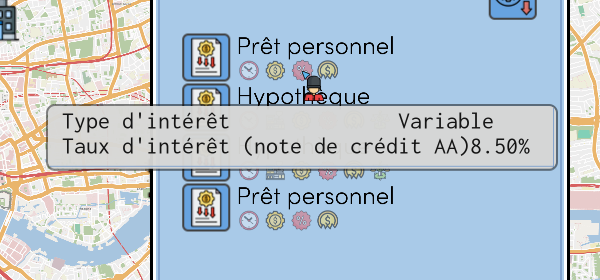
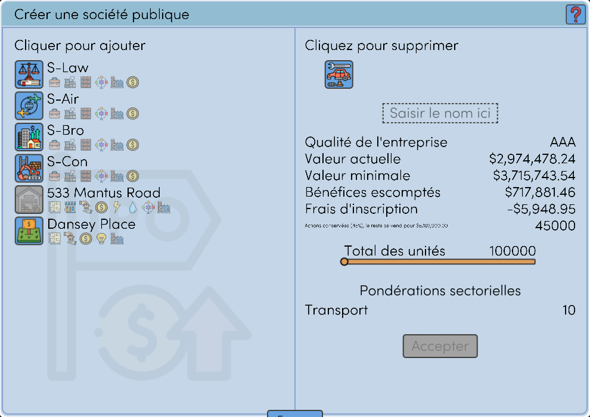
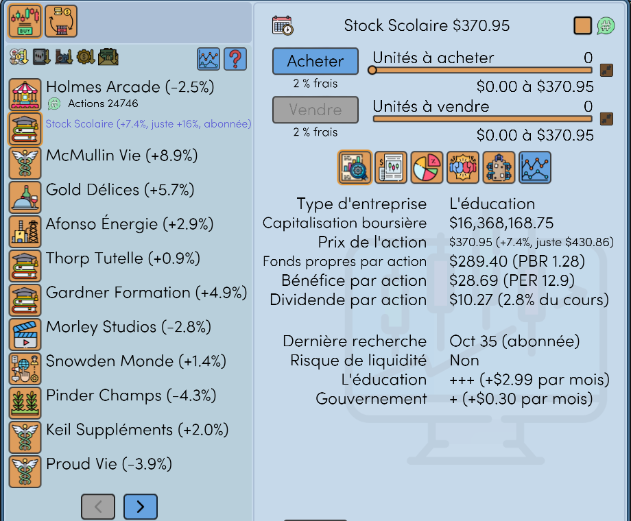
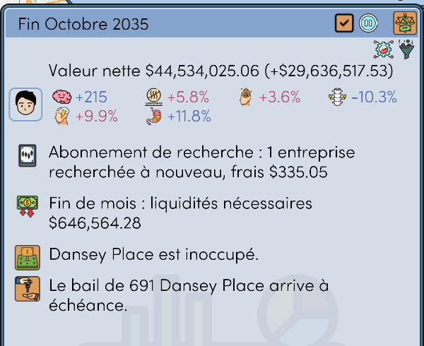
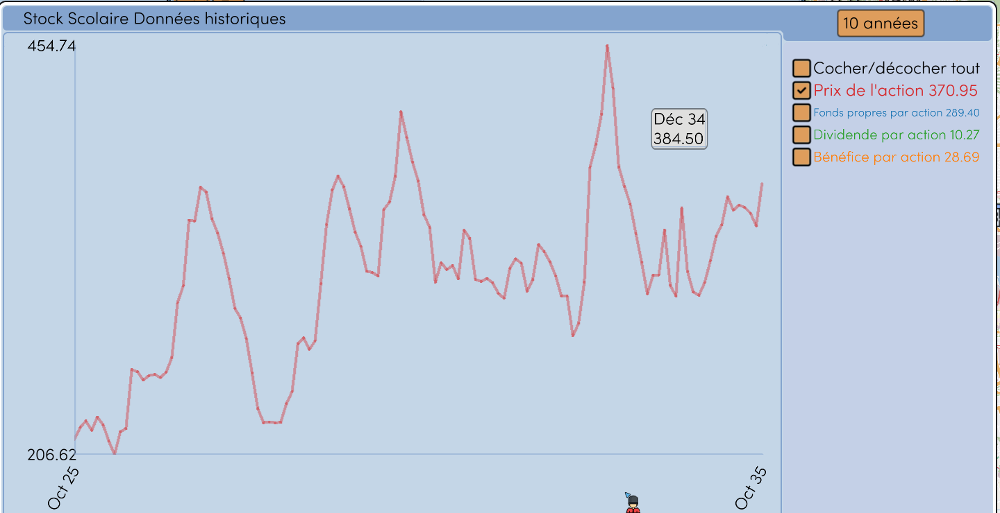
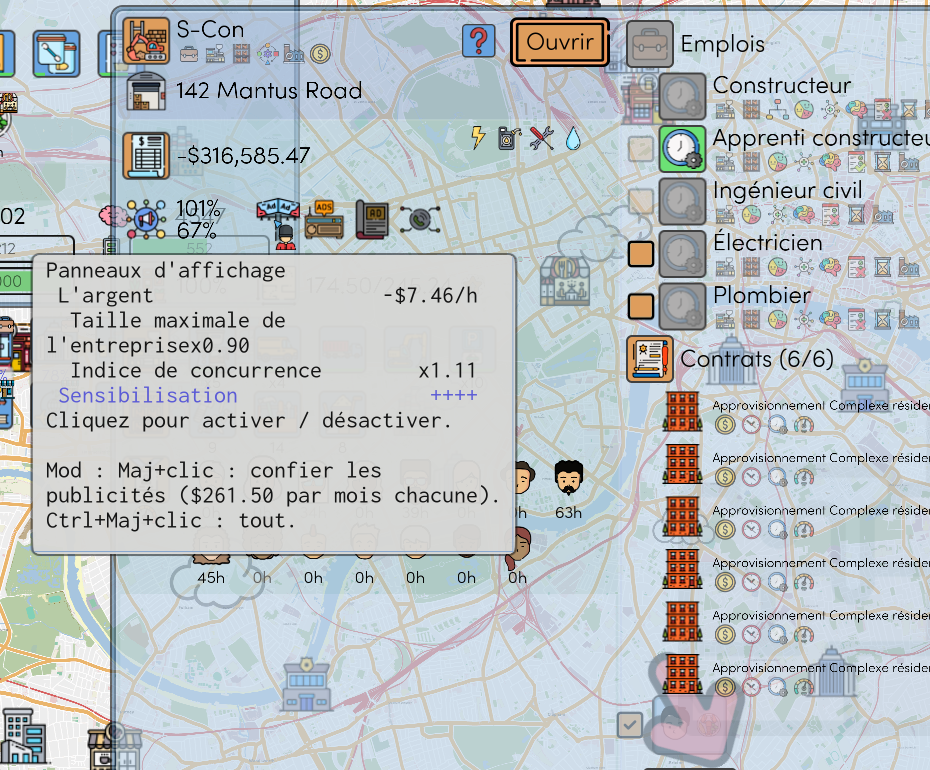
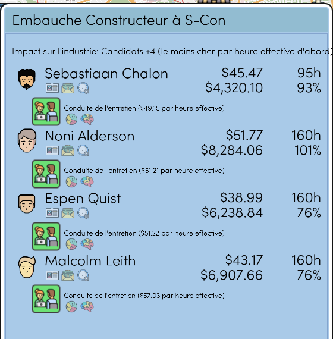

# Realistic Economy

Un mod pour This Grand Life 2. Uniquement pour la version v1.03.22 du jeu, version 1.5.0 du mod. Il n'est pas du développeur du jeu.

Autres langues : [English](README.md), [한국어](README.ko.md), [Deutsch](README.de.md), [Español](README.es.md), [Português (Brasil)](README.pt-BR.md), [日本語](README.ja.md), [简体中文](README.zh-CN.md)

## Le taux des prêts suit votre note de crédit

Taux = taux d'intérêt de la Banque centrale + une marge. La note de crédit de votre ménage (de AAA à B) fixe la marge. Moins de dette et plus de revenus et de liquidités donnent une meilleure note.

## Une introduction en bourse vous verse de l'argent

Le jeu vous donne 25 % des actions et pas d'argent. Avec le mod vous gardez 45 %, et les 55 % restants sont vendus au prix d'introduction. La petite ligne sous les frais d'inscription indique cet argent.

## Actions : indicateurs, abonnement de recherche, sièges au conseil

- À côté du cours de l'action : la variation depuis le mois dernier, PBR, PER et rendement du dividende.
- Maj+clic sur une entreprise vous abonne à sa recherche. Le mod la refait chaque mois, contre des frais, et affiche son juste prix. Ctrl+Maj+clic abonne toutes les entreprises.
- Chaque part de 20 % des actions d'une entreprise cotée garantit un siège au conseil d'administration. Vous nommez un membre de votre ménage pendant le mois de l'élection.

Le résumé mensuel indique la recherche et ses frais, ainsi que les liquidités que cette fin de mois va prendre.

## Graphiques

Le graphique d'une entreprise s'ouvre avec le seul cours de l'action. Chaque ligne a sa couleur, et sa dernière valeur s'affiche à côté de son nom. Le bouton de durée propose maintenant six mois.

## Automatisation des entreprises

Les salariés, les actifs, les publicités et les contrats peuvent être confiés au mod un par un, pour chaque entreprise. Ctrl+Maj+clic sur une icône de publicité confie tout. Les info-bulles des icônes indiquent les clics. Confier s'ouvre une fois que votre foyer a introduit en bourse une entreprise à lui (IPO). Ce qui manque encore de bras est sous-traité ou embauché quand cela coûte moins que la réputation gardée. Une nouvelle entreprise sans personne, confiée en entier, est lancée par le mod : ses premiers salariés, ses actifs et ses stocks.

L'onglet d'embauche affiche d'abord celui qui fait le même travail pour moins cher (rémunération à l'heure ÷ efficacité du travail).

## Défauts du jeu corrigés

- Le jeu se fermait après quelques dizaines de chargements de sauvegarde
- Des traductions fausses dans plusieurs langues
- Des carrés à la place des lettres dans les noms des personnes
- Un prêt immobilier supérieur au montant approuvé par la banque
- Un virement automatique mensuel qui achetait des actions sans liquidités
- Une égalité lors d'une élection du conseil qui fermait le jeu
- Un contrat de construction qui ne demandait jamais son ingénieur civil

## Affaire de goût, et comment la désactiver

Voici toutes les fonctions qui changent une règle ou un chiffre du jeu. Mettez la valeur à 0 dans `RealisticEconomy.ini`, dans le dossier du jeu, et cette partie redevient celle du jeu.

| Fonction | Ce qui change par rapport au jeu | Désactiver |
|---|---|---|
| Équilibrage | Frais sur les actions 2 % (jeu : 1 %), frais des contrats à terme 10 % de la marge (1 %), un taux d'épargne plus élevé et des intérêts sur les liquidités, un loyer qui peut aussi baisser au renouvellement, une nouvelle entreprise commence avec 25 % de sensibilisation (0 %) | `[features] balance=0` |
| Blocage des transactions après un chargement | Après le chargement d'une sauvegarde antérieure, les transactions sur actions et contrats à terme sont refusées jusqu'à ce que ce mois soit de nouveau passé. Les cours et les biens en vente du mois restent les mêmes après un chargement | `[features] guard=0` |
| Taux selon la note de crédit | Le taux d'un prêt suit la note de crédit du foyer | `[features] credit=0` |
| Introduction en bourse | Vous gardez 45 % et recevez de l'argent pour le reste (jeu : 25 %, pas d'argent) | `[features] ipo=0` |
| Sièges au conseil | Un siège garanti pour chaque tranche de 20 % des actions | `[features] board=0` |
| Casino | Mise et chances fixes, chaque jeu une fois par mois | `[features] casino=0` |
| Formation terminée | Sa valeur ne baisse pas | `[features] experience=0` |
| Automatisation des entreprises | Le mod gère le personnel, les actifs, les publicités et les contrats seulement dans une entreprise que vous lui confiez. Le même clic la reprend | `[features] business=0` |
| Concurrence | Sur le marché d'un type d'entreprise, les entreprises comptent 1,25 fois : la concurrence arrive plus tôt | `[balance] competitionWeight=1` |
| Bonus de réputation | Le bonus mensuel d'une entreprise pour le travail achevé (3,6 points) baisse avec la part de travail non faite et disparaît à 2 %, au lieu d'être perdu en entier pour une heure | `[balance] reputationBonusFade=0` |
| L'argent contre de l'influence | Deux grands dons à la banque ($1M, $10M) ; la ville vote sur ses politiques tous les 12 mois (jeu : 24) ; le don propre au jeu une fois par an (jeu : chaque mois) | `[features] influence=0` |
| Coaching personnel | À l'hôpital, contre de l'argent, une préférence choisie se rapproche d'un cran de « aime » ; une par an et par personne | `[features] coaching=0` |

Chaque chiffre de l'équilibrage a sa propre ligne sous `[balance]`.

## Autres fonctions

Chacune peut être désactivée dans le fichier de réglages.

- Les candidats d'un mois restent les mêmes après un chargement
- Un avis quand un bien est en vente nettement sous sa valeur
- Dans la fenêtre qui choisit le type d'une nouvelle entreprise : les ventes et les coûts d'un mois avec tous ses clients

## Installation

1. Fermez le jeu.
2. Extrayez le zip des [Releases](../../releases) dans le dossier du jeu (là où se trouve `TGL2.exe`).
3. Lancez `RealisticEconomy_install.bat`. Il copie d'abord vos sauvegardes dans `saves_before_RealisticEconomy_1`.

Pour retirer le mod, lancez `RealisticEconomy_uninstall.bat`. Les réglages sont dans `RealisticEconomy.ini`. Le manuel complet est en anglais : [docs/RealisticEconomy_README_en.txt](docs/RealisticEconomy_README_en.txt).

Un antivirus peut signaler `version.dll`. C'est l'Ultimate ASI Loader, qui est public. Après une mise à jour du jeu, le mod se désactive de lui-même.

Licence MIT. Le code source est dans [src](src).
