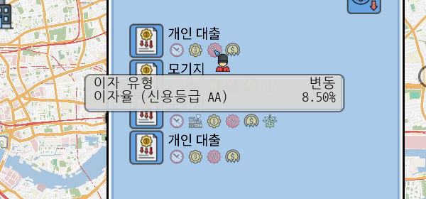
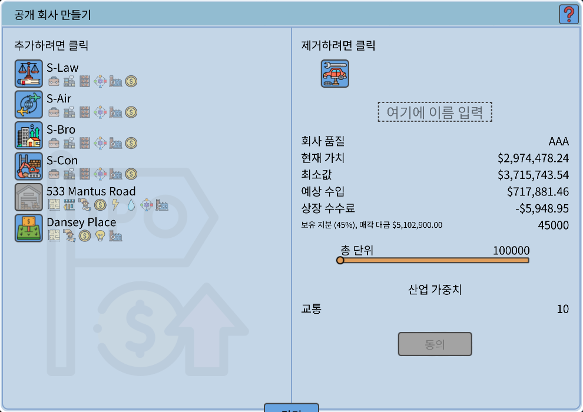
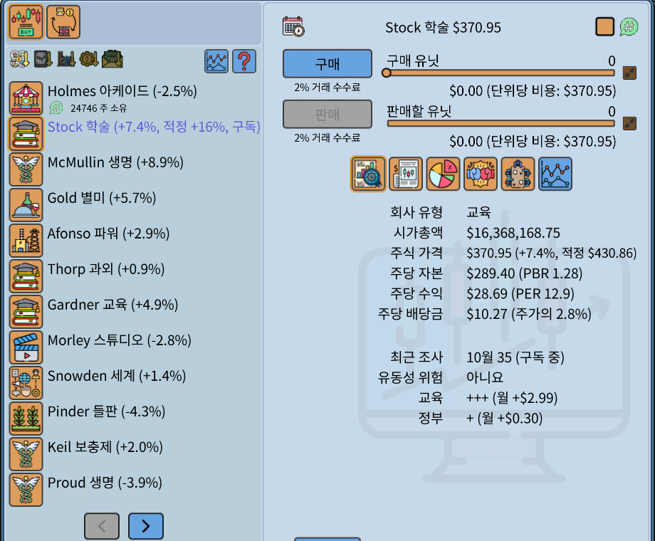
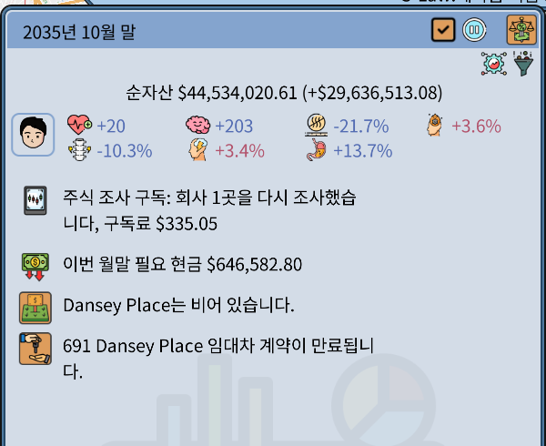
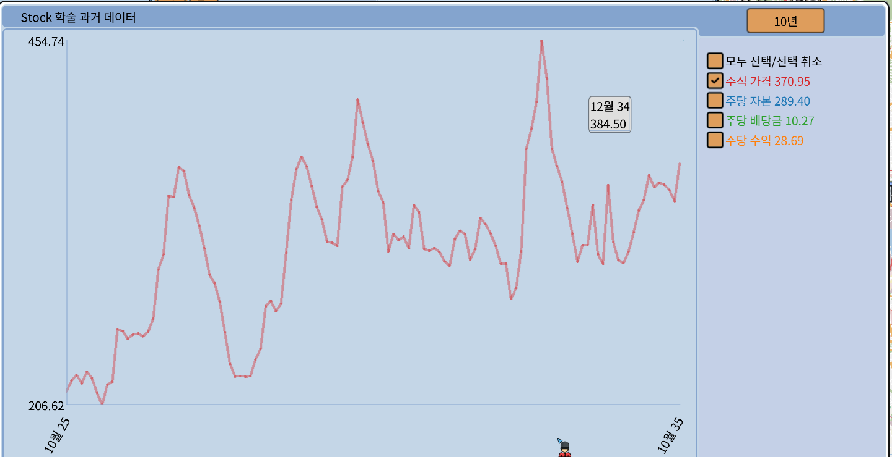
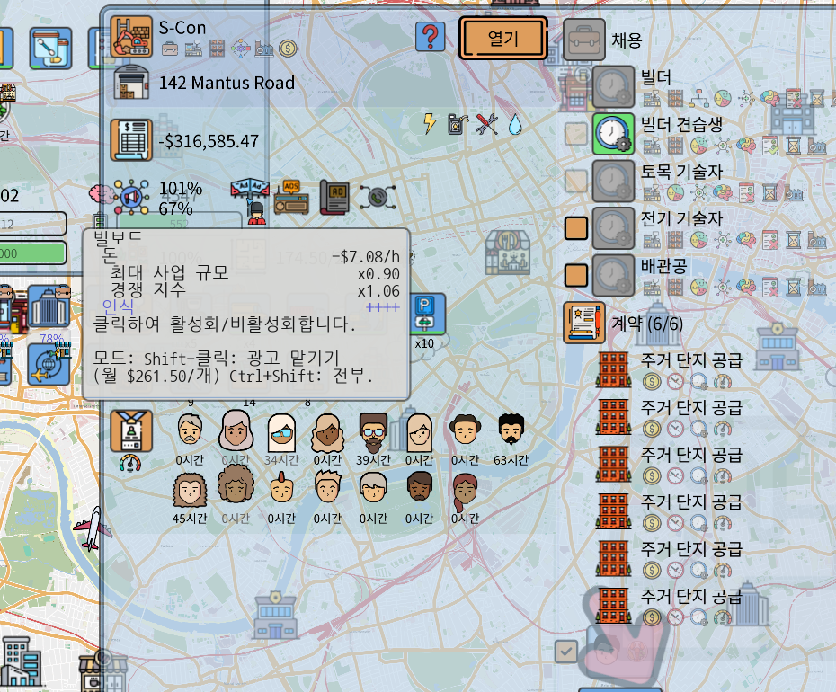
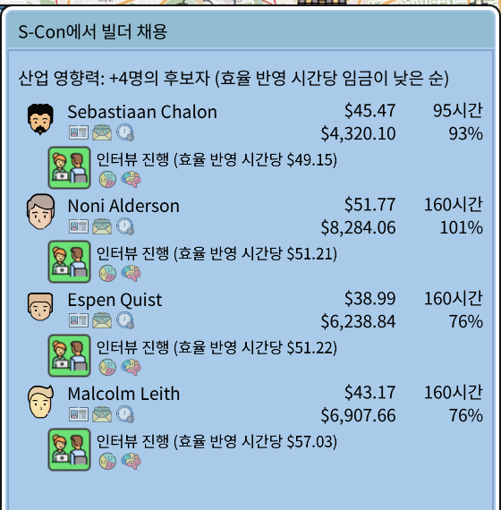

# Realistic Economy

This Grand Life 2 모드입니다. 게임 v1.03.22 전용, 모드 버전 1.6.0. 게임 제작사가 만든 것이 아닙니다.

다른 언어: [English](README.md), [Deutsch](README.de.md), [Español](README.es.md), [Français](README.fr.md), [Português (Brasil)](README.pt-BR.md), [日本語](README.ja.md), [简体中文](README.zh-CN.md)

## 대출 금리가 신용등급을 따릅니다

금리 = 중앙은행 금리 + 가산금리. 가산금리는 가계의 신용등급(AAA ~ B)이 정합니다. 빚이 적고 소득과 현금이 넉넉하면 등급이 좋아집니다.

## 상장하면 현금을 받습니다

원래 게임은 주식의 25% 만 주고 현금은 주지 않습니다. 모드에서는 45% 를 갖고 나머지 55% 를 상장가에 판 돈을 받습니다. 상장 수수료 아래의 작은 줄이 그 금액입니다.

## 주식: 지표, 조사 구독, 이사회 자리

- 주가 옆에 지난달 대비 변동률, PBR, PER, 배당수익률이 나옵니다.
- 회사를 Shift-클릭하면 조사를 구독합니다. 모드가 수수료를 받고 달마다 다시 조사해서 적정 주가를 보여 줍니다. Ctrl+Shift-클릭은 모든 회사를 구독합니다.
- 상장 회사의 주식 20% 마다 이사회 한 자리가 보장됩니다. 선거가 있는 달에 가계 구성원을 지명하면 됩니다.

조사 결과와 수수료, 이번 월말에 나갈 현금은 월간 요약에 나옵니다.

## 차트

회사 차트는 주가 선만 켠 채로 열립니다. 선마다 색이 다르고 이름 옆에 마지막 값이 붙습니다. 기간 버튼에 6개월이 생겼습니다.

## 사업체 자동화

직원, 자산, 광고, 계약을 사업체마다 하나씩 모드에 맡길 수 있습니다. 광고 아이콘을 Ctrl+Shift-클릭하면 전부 맡깁니다. 누르는 법은 아이콘의 설명 글에 나옵니다. 맡기기는 우리 가계가 회사를 한 번 상장(IPO)한 뒤에 열립니다. 일손이 모자란 몇 시간은 지키는 평판보다 싸면 외주나 채용으로 채웁니다. 직원이 없는 새 사업체도 전부 맡기면 모드가 첫 직원과 자산, 재고를 갖춰 시작합니다. 불러온 직후와 맡긴 직후에도 바로 살피고, 달의 첫 시간에 그달 인원을 한꺼번에 갖춥니다. 월말이 가까우면 지키는 평판이 한 달 월급만큼 값질 때만 뽑습니다.

채용 창은 같은 일을 싸게 하는 사람부터 보여 줍니다(시간당 임금 ÷ 업무 효율).

## 고친 게임 버그

- 세이브를 수십 번 불러오면 게임이 꺼지던 문제
- 틀린 번역(고정 금리가 "수정됨"으로, 초등학교가 "학년 학교"로 나오던 것 등 한국어 삼백 곳 넘게. 다른 언어도 고쳤습니다)
- 사람 이름의 글자가 네모로 나오던 문제
- 은행이 승인한 금액보다 큰 모기지가 나가던 문제
- 월별 자동 이체가 현금 없이 주식을 사던 문제
- 이사회 선거에서 동점이 나오면 게임이 꺼지던 문제
- 건설 계약 하나가 토목 기술자를 요구하지 않던 문제

## 취향이 갈리는 기능과 끄는 법

게임의 규칙이나 숫자를 바꾸는 기능은 아래가 전부입니다. 게임 폴더의 `RealisticEconomy.ini` 에서 값을 0 으로 바꾸면 그 부분은 게임 원래대로 돌아갑니다.

| 기능 | 게임과 달라지는 것 | 끄는 설정 |
|---|---|---|
| 밸런스 | 주식 수수료 2%(게임 1%), 선물 수수료 마진의 10%(1%), 더 높은 저축 금리와 현금 이자, 갱신 때 내려가기도 하는 임대료, 새 사업체의 인지도 25%(0%) | `[features] balance=0` |
| 로드 뒤 거래 잠금 | 예전 세이브를 불러오면 그 달이 다시 지날 때까지 주식·선물 거래가 잠깁니다. 그 달의 주가와 부동산 매물은 불러와도 같습니다 | `[features] guard=0` |
| 신용등급 금리 | 대출 금리가 가계의 신용등급을 따릅니다 | `[features] credit=0` |
| 상장 | 45% 를 갖고 나머지를 판 현금을 받습니다(게임: 25%, 현금 없음) | `[features] ipo=0` |
| 이사회 자리 | 주식 20% 마다 한 자리가 보장됩니다 | `[features] board=0` |
| 카지노 | 정해진 판돈과 확률, 게임마다 한 달에 한 번 | `[features] casino=0` |
| 마친 교육 | 수치가 깎이지 않습니다 | `[features] experience=0` |
| 사업체 자동화 | 맡긴 사업체에서만 모드가 직원·자산·광고·계약을 관리합니다. 같은 클릭으로 되찾습니다 | `[features] business=0` |
| 경쟁 | 업종 시장에서 회사들의 몫을 1.25배로 셉니다. 경쟁이 더 일찍 붙습니다 | `[balance] competitionWeight=1` |
| 평판 가산 | 사업체의 월말 "완료된 작업" 가산(3.6포인트)이 못 한 일의 비율에 따라 줄어 2% 에서 0 이 됩니다. 한 시간만 남겨도 통째로 잃던 것이 없어집니다 | `[balance] reputationBonusFade=0` |
| 돈으로 영향력 | 은행에 큰 기부 둘($1M, $10M), 시의 정책 투표는 12개월마다(게임 24개월), 게임 자체의 기부는 1년에 한 번(게임은 다달이) | `[features] influence=0` |
| 개인 코칭 | 병원에서 돈을 내고, 고른 성향 하나를 좋아함 쪽으로 한 단계 옮깁니다(사람마다 1년에 하나) | `[features] coaching=0` |

밸런스의 숫자는 `[balance]` 에 하나씩 줄이 있습니다.

## 그 밖의 기능

설정 파일에서 하나씩 끌 수 있습니다.

- 그 달의 채용 지원자는 불러와도 그대로
- 가치보다 많이 싼 부동산이 나오면 알림
- 새 사업체의 종류를 고르는 창에 손님이 다 찼을 때의 한 달 매출과 비용
- 가족 구성원에게 더 나은 일자리가 나면 알림: 같은 직장의 같은 직업으로 시급이 확실히 높은 자리, 또는 자격이 되는 같은 계통의 한 단계 위 직업

## 설치

1. 게임을 끕니다.
2. [Releases](../../releases) 의 zip 을 게임 폴더(`TGL2.exe` 가 있는 곳)에 풉니다.
3. `RealisticEconomy_install.bat` 을 실행합니다. 세이브를 먼저 `saves_before_RealisticEconomy_1` 에 복사해 둡니다.

지울 때는 `RealisticEconomy_uninstall.bat` 을 실행합니다. 설정은 `RealisticEconomy.ini` 에 있습니다. 자세한 설명서는 [docs/RealisticEconomy_README_ko.txt](docs/RealisticEconomy_README_ko.txt) 입니다.

백신이 `version.dll` 을 의심할 수 있습니다. 공개된 Ultimate ASI Loader 입니다. 게임이 업데이트되면 모드는 스스로 꺼집니다.

MIT 라이선스. 소스는 [src](src) 에 있습니다.
