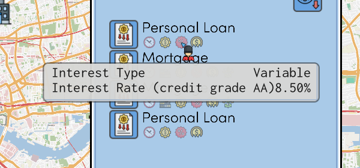
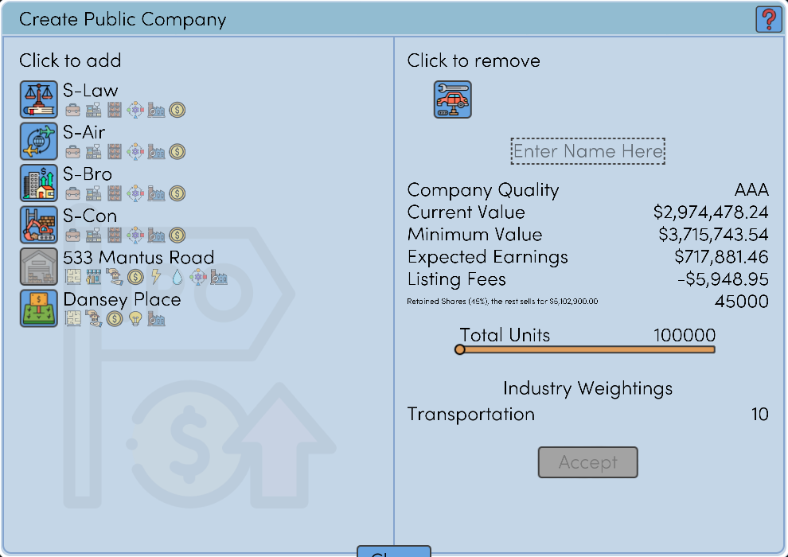
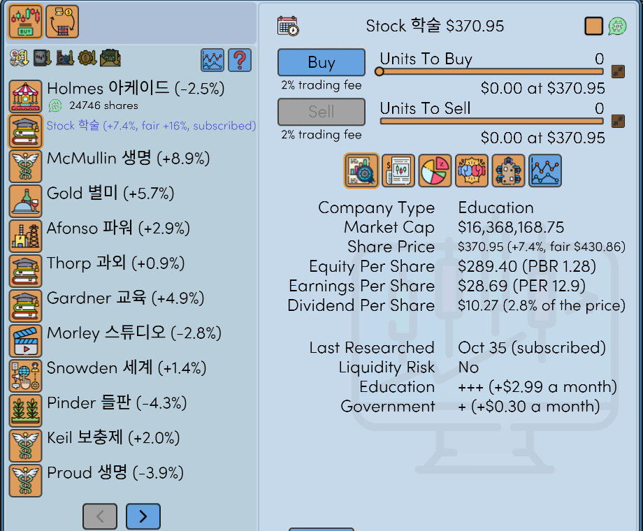
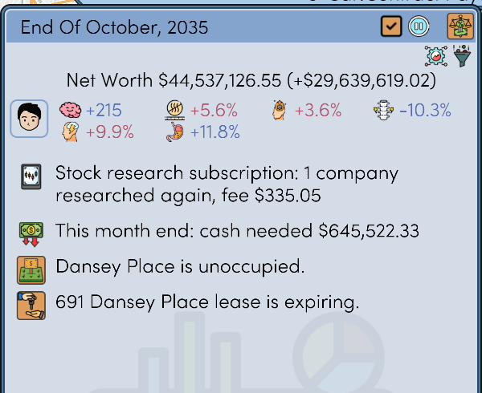
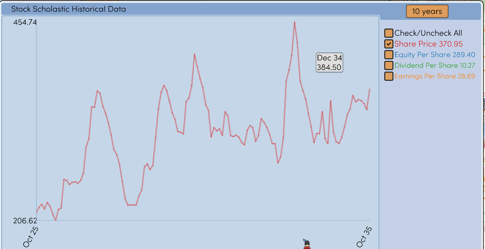
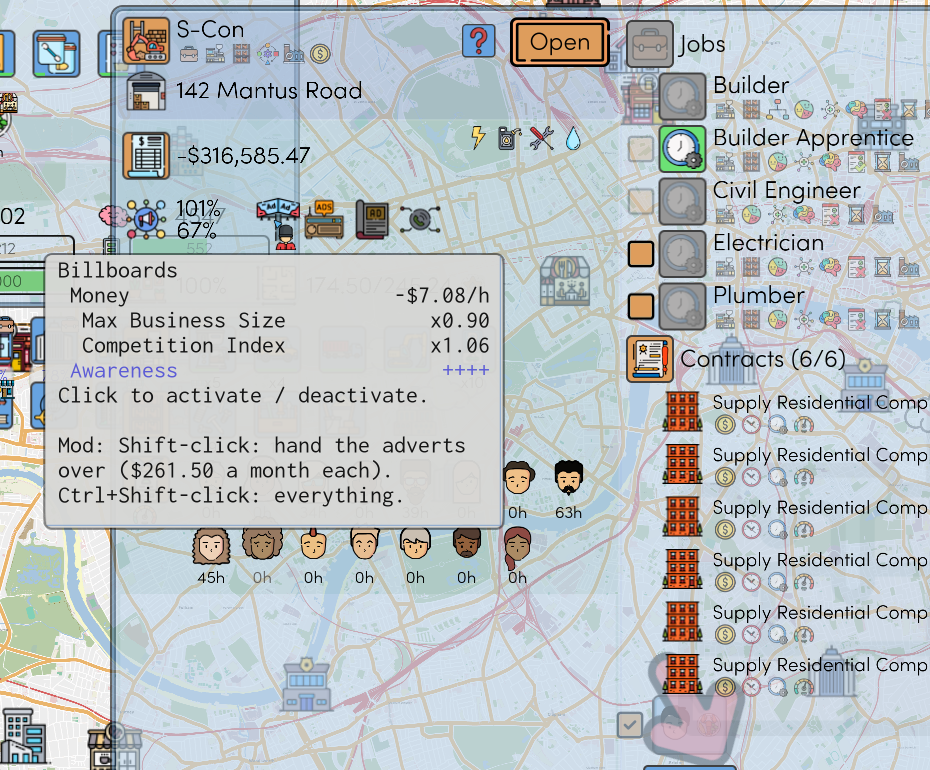
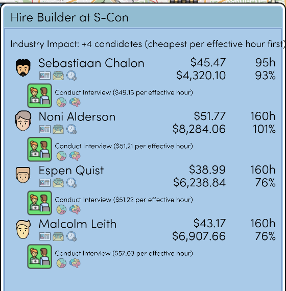

# Realistic Economy

A mod for This Grand Life 2. Game v1.03.22 only, mod version 1.6.1. Not made by the game's developer.

Other languages: [한국어](README.ko.md), [Deutsch](README.de.md), [Español](README.es.md), [Français](README.fr.md), [Português (Brasil)](README.pt-BR.md), [日本語](README.ja.md), [简体中文](README.zh-CN.md)

## Loan interest follows your credit grade

Rate = central bank rate + a margin. Your household's credit grade (AAA to B) sets the margin. Less debt and more income and cash give a better grade.

## An IPO pays you cash

The game gives you 25% of the shares and no cash. With the mod you keep 45%, and the other 55% is sold at the listing price. The small line under the listing fee shows that cash.

## Stocks: ratios, research subscription, board seats

- Next to the share price: the change from last month, PBR, PER and dividend yield.
- Shift-click a company to subscribe to its research. The mod researches it again every month, for a fee, and shows its fair price. Ctrl+Shift-click subscribes every company.
- Every 20% of a listed company's shares guarantees one board seat. You nominate a household member in the month of the election.

The monthly summary reports the research and its fee, and the cash this month end will take.

## Charts

A company's chart opens with the share price alone. Each line has its own colour, and its last value stands next to its name. The time button now has six months.

## Business automation

Staff, assets, adverts and contracts can be handed to the mod one by one, for each business. Ctrl+Shift-click an advert icon to hand over everything. The icons' hover texts tell you the clicks. Handing over opens once your household has listed a company of its own (IPO). What is still short of hands is outsourced or hired for when that costs less than the reputation it keeps. A new business with nobody in it, handed over whole, is started by the mod: its first staff, its assets and its inventory. The mod looks right after a load or a hand-over, and at a month's first hour it hires for the whole month. Near a month end it hires only when the reputation it keeps is worth a month's wage.

The hire tab lists first who does the same work for less (pay per hour ÷ work efficiency).

## Game bugs fixed

- The game shutting down after a few dozen loads of a save
- Wrong translations in several languages
- Boxes in place of letters in people's names
- A mortgage larger than the amount the bank approved
- A monthly auto-transfer rule that bought shares without cash
- A tie in a board election that ended the game
- A construction contract that never asked for its civil engineer

## What is a matter of taste, and how to switch it off

These are all the features that change a rule or a number of the game. Set the value to 0 in `RealisticEconomy.ini` in the game folder and that part is the game as it was.

| Feature | What differs from the game | Off |
|---|---|---|
| Balance | Share fee 2% (the game: 1%), futures fee 10% of the margin (1%), a higher savings rate and interest on cash, a rent that can come down at a renewal, a new business starts with 25% awareness (0%) | `[features] balance=0` |
| Loan rates by credit grade | A loan's rate follows the household's credit grade | `[features] credit=0` |
| Listing | You keep 45% and get cash for the rest (the game: 25%, no cash) | `[features] ipo=0` |
| Board seats | One guaranteed seat for every 20% of the shares | `[features] board=0` |
| Casino | Set stakes and odds, each game once a month | `[features] casino=0` |
| Completed education | Its value does not decay | `[features] experience=0` |
| Business automation | The mod manages staff, assets, adverts and contracts only in a business you hand over. The same click takes it back | `[features] business=0` |
| Competition | In a business type's market the firms count 1.25 times, so competition sets in earlier | `[balance] competitionWeight=1` |
| Reputation bonus | A business's monthly bonus for completed work (3.6 points) goes down with the share of work left undone, to nothing at 2%, instead of being lost for one hour | `[balance] reputationBonusFade=0` |
| Money into influence | Two large donations at a bank ($1M, $10M); the city votes on its policies every 12 months (the game: 24); the game's own donation once a year (the game: every month) | `[features] influence=0` |
| Personal Coaching | At a hospital, for money, a preference you choose moves one step towards a like; one a year for each person | `[features] coaching=0` |

Each number of the balance has its own line under `[balance]`.

Off unless you switch it on (since 1.6.1): a trade lock after a load. With `[features] guard=1`, after you load an earlier save, share and futures trades are refused until that month has passed again, and the month's share prices and properties for sale stay the same after a load.

## Other features

Each can be switched off in the settings file.

- The month's job candidates stay the same after a load
- A notice when a property is for sale well under its value
- In the window that picks a new business's type: a month's sales and costs once all its customers come
- A notice when a better job opens for a household member: the same job at the same workplace for more an hour, or the next step of the member's career that the member qualifies for

## Install

1. Close the game.
2. Extract the zip from [Releases](../../releases) into the game folder (where `TGL2.exe` is).
3. Run `RealisticEconomy_install.bat`. It copies your saves to `saves_before_RealisticEconomy_1` first.

To remove the mod, run `RealisticEconomy_uninstall.bat`. The settings are in `RealisticEconomy.ini`. The full manual is [docs/RealisticEconomy_README_en.txt](docs/RealisticEconomy_README_en.txt).

An antivirus may flag `version.dll`. It is the public Ultimate ASI Loader. After a game update the mod switches itself off.

MIT licence. The source is in [src](src).
