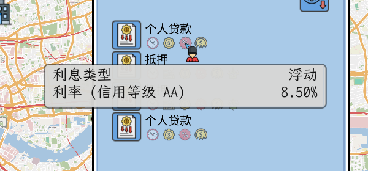
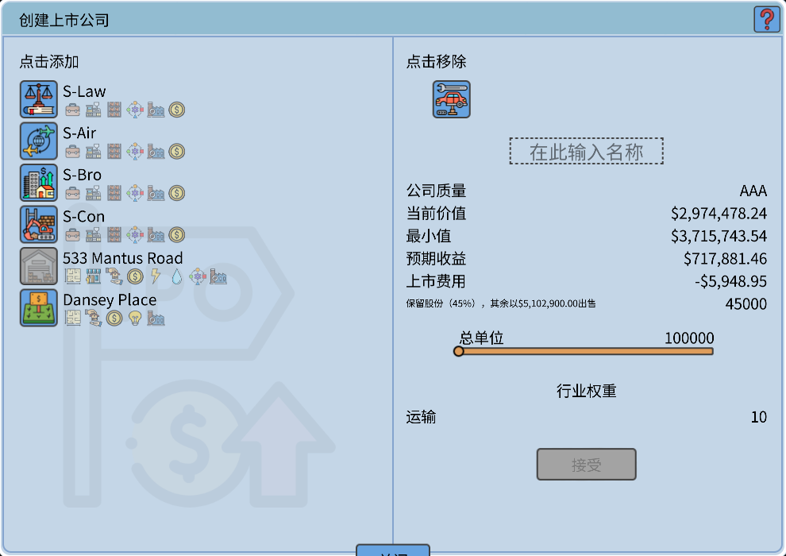
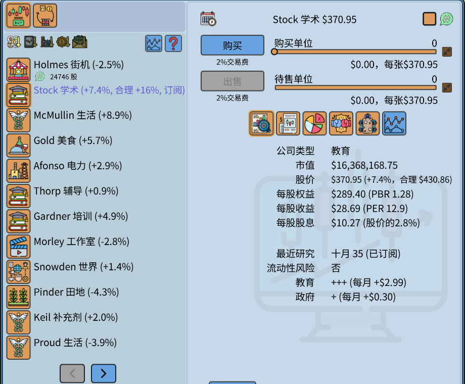
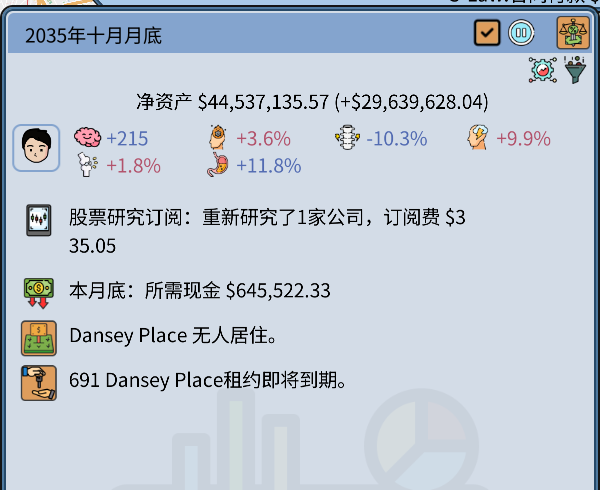
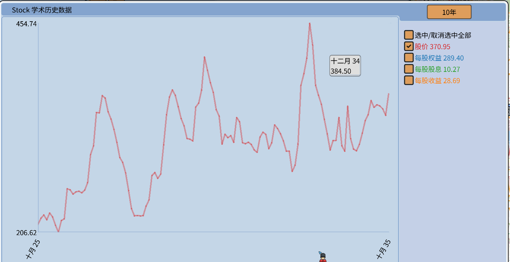
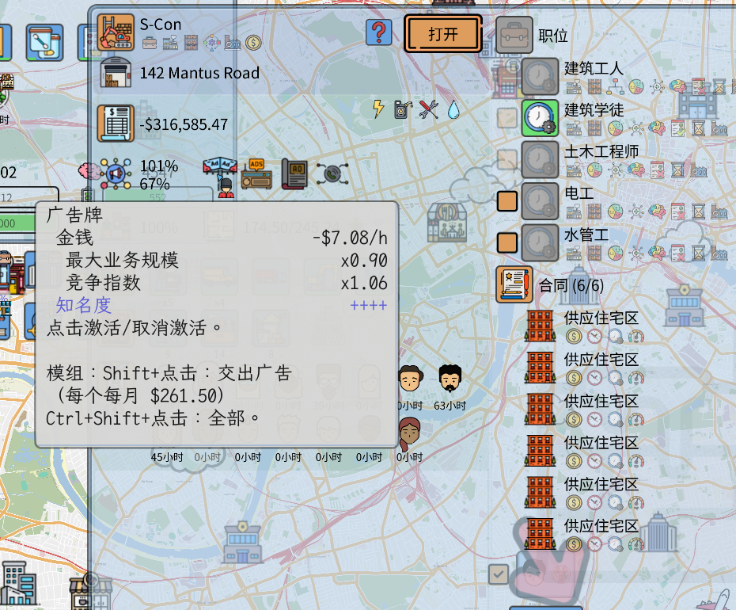
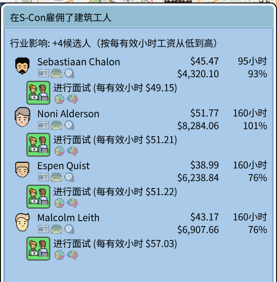

# Realistic Economy

This Grand Life 2 的模组。仅适用于游戏 v1.03.22，模组版本 1.5.1。不是游戏开发商制作的。

其他语言：[English](README.md)、[한국어](README.ko.md)、[Deutsch](README.de.md)、[Español](README.es.md)、[Français](README.fr.md)、[Português (Brasil)](README.pt-BR.md)、[日本語](README.ja.md)

## 贷款利率取决于信用等级

利率 = 中央银行利率 + 加点。加点由家庭的信用等级（AAA 到 B）决定。债务少、收入和现金多，等级就高。

## 上市可以拿到现金

原版游戏只给你 25% 的股份，没有现金。使用模组后你保留 45%，其余 55% 按上市价卖出，现金归你。上市费用下面的小字一行就是这笔钱。

## 股票：指标、研究订阅、董事会席位

- 股价旁边显示较上月的变化、PBR、PER 和股息率。
- Shift+点击一家公司即可订阅它的研究。模组每月收费重新研究，并显示合理股价。Ctrl+Shift+点击订阅所有公司。
- 一家上市公司每 20% 的股份保证一个董事会席位。在选举的那个月提名一名家庭成员即可。

研究的结果和费用，以及本月底需要的现金，都显示在每月总结里。

## 图表

公司的图表打开时只显示股价线。每条线颜色不同，名称旁边带有最新数值。时间按钮增加了 6 个月。

## 业务自动化

员工、资产、广告和合同，可以按业务逐项交给模组。Ctrl+Shift+点击广告图标可以全部交出。操作方法写在图标的说明文字里。要在你的家庭让一家自己的公司上市（IPO）之后才能交给模组。缺人手的几个小时，如果比保住的声誉便宜，就用外包或招聘补上。没有员工的新业务全部交给模组后，模组会招来第一批员工，买齐资产和库存，让它开始营业。读档后和交给模组后会立刻检查，并在每月第一个小时一次配齐当月人手。临近月底时，只有保住的声誉值得一个月工资时才会招聘。

招聘标签页先显示用更低成本做同样工作的人（每小时工资 ÷ 工作效率）。

## 修复的游戏问题

- 读取存档几十次后游戏会关闭
- 多种语言里的翻译错误
- 人名中的字母显示成方框
- 抵押贷款超过银行批准的金额
- 每月自动转账在没有现金时买入股票
- 董事会选举出现平票时游戏关闭
- 一份建筑合同从不要求土木工程师

## 见仁见智的功能，以及关闭方法

改变游戏规则或数值的功能全部列在下面。在游戏文件夹的 `RealisticEconomy.ini` 里把值改成 0，这一部分就恢复成原版游戏。

| 功能 | 与原版的不同 | 关闭的设置 |
|---|---|---|
| 平衡 | 股票手续费 2%（原版 1%），期货手续费为边距的 10%（1%），储蓄利率更高且现金也有利息，续租时租金也可能下降，新业务以 25% 的知名度起步（0%） | `[features] balance=0` |
| 读档后的交易锁定 | 读取以前的存档后，在那个月再次过去之前不能交易股票和期货。当月的股价和在售房产读档后不变 | `[features] guard=0` |
| 按信用等级定利率 | 贷款利率取决于家庭的信用等级 | `[features] credit=0` |
| 上市 | 你保留 45%，其余部分卖出换成现金（原版：25%，没有现金） | `[features] ipo=0` |
| 董事会席位 | 每 20% 的股份保证一个席位 | `[features] board=0` |
| 赌场 | 固定的赌注和概率，每种游戏每月一次 | `[features] casino=0` |
| 已完成的教育 | 数值不会降低 | `[features] experience=0` |
| 业务自动化 | 只有在你交给模组的业务里，模组才管理员工、资产、广告和合同。同样的点击可以收回 | `[features] business=0` |
| 竞争 | 在业务类型的市场中，公司的份额按 1.25 倍计算，竞争来得更早 | `[balance] competitionWeight=1` |
| 声誉奖励 | 业务每月的“已完成的工作”奖励（3.6 点）随未完成工作的比例减少，到 2% 为零，不再因为剩下一个小时就全部失去 | `[balance] reputationBonusFade=0` |
| 用钱换影响力 | 银行新增两笔大额捐款（$1M、$10M）；城市每 12 个月就政策投票一次（原版 24 个月）；原版自带的捐款每年一次（原版每月） | `[features] influence=0` |
| 个人辅导 | 在医院付钱，可让选定的一项偏好向“喜欢”靠近一级，每人每年一项 | `[features] coaching=0` |

平衡的每个数值在 `[balance]` 下各有一行。

## 其他功能

每一项都可以在设置文件里关闭。

- 当月的求职候选人读档后不变
- 有房产以远低于价值的价格出售时给出提示
- 选择新业务类型的窗口里，客满时一个月的销售额和成本

## 安装

1. 关闭游戏。
2. 把 [Releases](../../releases) 里的 zip 解压到游戏文件夹（`TGL2.exe` 所在的位置）。
3. 运行 `RealisticEconomy_install.bat`。它会先把你的存档复制到 `saves_before_RealisticEconomy_1`。

要移除模组，请运行 `RealisticEconomy_uninstall.bat`。设置在 `RealisticEconomy.ini` 里。完整的说明书是英文的：[docs/RealisticEconomy_README_en.txt](docs/RealisticEconomy_README_en.txt)

杀毒软件可能会对 `version.dll` 报警。它是公开的 Ultimate ASI Loader。游戏更新后，模组会自行关闭。

MIT 许可证。源代码在 [src](src) 里。
